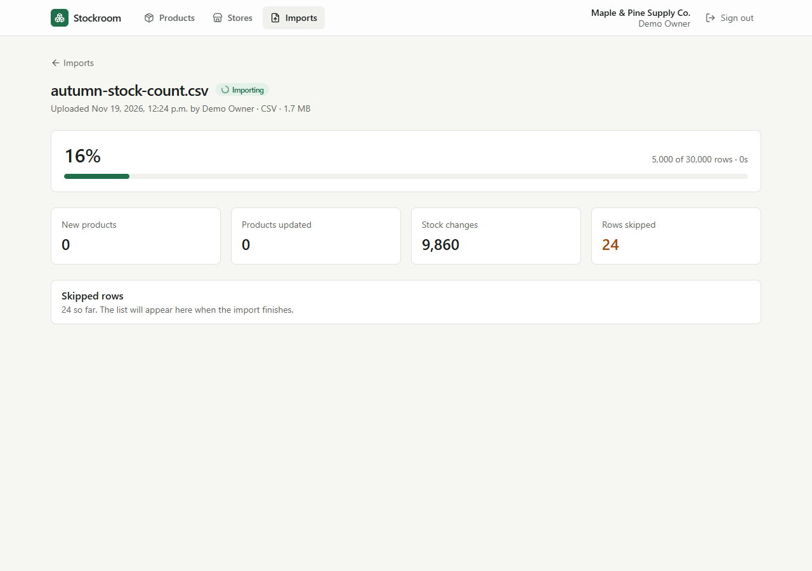
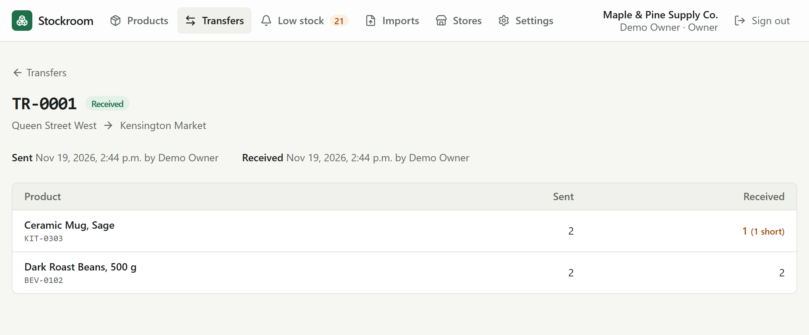
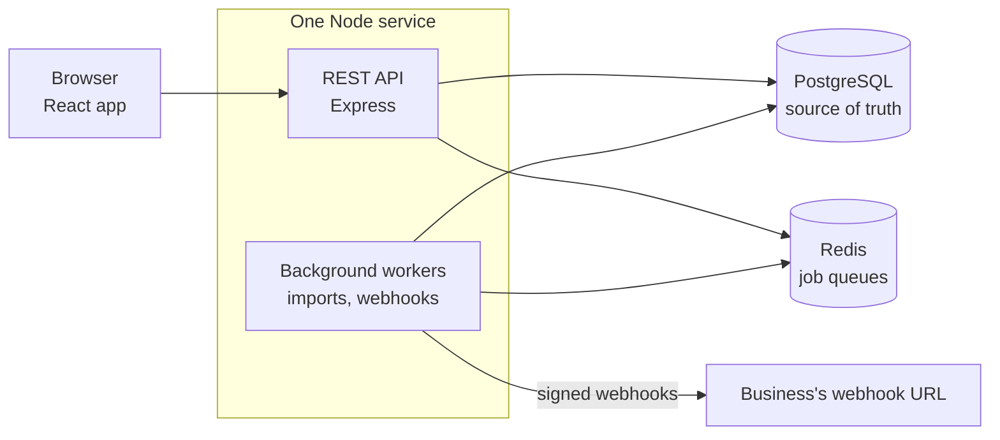

# Stockroom

Inventory management for small retail chains. Track stock across stores, move it between them, import big spreadsheets, and see what's running low before it runs out.

**[Live demo](https://stockroom-5x6w.onrender.com)**: press **Try the demo** to get your own sample business for 24 hours, with no sign-up. It runs on free hosting, so the first visit after a quiet spell can take about a minute while the server wakes up.


## About

Stockroom is a full-stack TypeScript app for shops with a few locations. Each business gets a private workspace with its own stores, products and staff.

- **Products and stock.** A catalogue with SKUs, prices and reorder points, and the stock in every store at a glance.
- **Stock history.** Every change (delivery, sale, damage, correction, import or transfer) is recorded with who made it and the balance after it.
- **Transfers between stores.** Send stock from one store to another, then record what actually arrived.
- **Bulk imports.** Upload a CSV or Excel file of up to 100,000 rows. It's processed in the background with live progress and a report of any rows that were skipped.
- **Low-stock alerts.** See what needs reordering, and have alerts sent to your own systems as signed webhooks.
- **Staff accounts.** Invite staff with single-use links. Staff can move stock; only owners can change prices and settings.

| Bulk import with live progress | A transfer, with what arrived |
|---|---|
|  |  |

## How it works

The project is also a system design exercise: it's built to stay correct when many things happen at once or something fails halfway.



- **Stock can't go negative or drift.** Every change is written to an append-only ledger in the same transaction as the balance, and a database constraint rejects overselling.
- **Imports survive crashes.** Files are processed in chunks of 1,000 rows by BullMQ workers. Each chunk is saved together with a checkpoint, so a crashed import resumes where it stopped without applying anything twice.
- **Events can't be lost.** Alerts and transfer events go through a transactional outbox and are delivered as HMAC-signed webhooks, with retries.
- **Retries are safe.** Stock changes accept an `Idempotency-Key` header, so a repeated request is applied once.
- **Fast at 100,000 products.** Load tests and query plans guided the tuning: the low-stock filter went from 1.6 s to 6 ms.
- **Free to host.** It runs as a single service on Render, with Neon for Postgres and Upstash for Redis, tuned to stay within their free limits.

The full design, with diagrams, failure modes and the reasons behind each decision, is in [docs](#documentation).

## Tech stack

| Area | Tools |
|---|---|
| Backend | Node.js, Express 5, TypeScript, Drizzle ORM, Zod |
| Database | PostgreSQL |
| Background jobs | BullMQ on Redis |
| Frontend | React 19, React Router, TanStack Query, Tailwind CSS, Vite |
| Testing | Vitest and Supertest, against real Postgres and Redis |
| Ops | GitHub Actions, Prometheus metrics, Render, Neon, Upstash |

## Run it locally

### Prerequisites

- **Node.js 22.12 or later**
- **Redis 6.2 or later**, running on `localhost:6379`:
  - macOS: `brew install redis && brew services start redis`
  - Linux: `sudo apt install redis-server`
  - Windows: install Redis inside WSL (`sudo apt install redis-server`), then start it with `wsl -- redis-server --daemonize yes`

You don't need Docker or a Postgres install: `npm run dev` downloads and starts a local Postgres server for you.

### Start the app

```bash
git clone https://github.com/iamrs77/stockroom.git
cd stockroom
npm install
npm run dev
```

This starts Postgres (port 5433), the API and background workers (port 3000), and the web app (port 5173). Database migrations run automatically.

Open **http://localhost:5173** and either:

- press **Try the demo** for a sample business, or
- create your own account.

### Optional: sample data

In a second terminal, create a demo account with 3 stores and 136 products:

```bash
npm run db:seed
```

Sign in with `demo@stockroom.app` / `stockroom-demo`.

To try a large import, generate a file and upload it on the **Imports** page while signed in to that account (the **Try the demo** businesses are limited to 2,000 rows):

```bash
npm run sample:import -- --rows 100000   # writes .data/imports/sample-100000.csv
```

### Settings and resetting

No configuration is needed locally. To change a setting, copy `.env.example` to `.env`; every option is described there.

Local data lives in `.data/postgres`. Stop the app and delete that folder to start fresh.

## Scripts

| Command | What it does |
|---|---|
| `npm run dev` | Starts Postgres, the API, the workers and the web app, reloading on changes |
| `npm test` | Runs the tests against a temporary Postgres and your local Redis |
| `npm run typecheck` | Type-checks every package |
| `npm run build` | Builds the web app and the server |
| `npm start` | Runs the production build |
| `npm run db:seed` | Recreates the demo account and its data |
| `npm run sample:import` | Writes a large import file (`--rows`, `--stores`, `--bad`) |
| `npm run bench` | Load-tests the API against 100,000 products |

## Project structure

The repository is a monorepo: the server, the web app and a package they share live side by side as npm workspaces, so one `npm install` sets up everything.

```
stockroom/
├── apps/
│   ├── server/                    Back end: the REST API and the background workers
│   │   ├── src/
│   │   │   ├── main.ts            Starts the app: database, migrations, Redis, workers, then the HTTP server
│   │   │   ├── app.ts             The Express app: middleware, API routes, and the built web app in production
│   │   │   ├── config.ts          Reads and checks the settings (environment variables)
│   │   │   ├── db/                Database tables (Drizzle schema), connection, migrations and demo data
│   │   │   ├── http/              Shared request handling: sign-in check, validation, idempotency keys, rate limits, errors
│   │   │   ├── modules/           One folder per feature (see the table below)
│   │   │   ├── redis.ts           Redis connection that reconnects by itself
│   │   │   ├── metrics.ts         Prometheus metrics
│   │   │   └── logger.ts          Structured logging (pino)
│   │   ├── drizzle/               SQL migrations, applied in order when the server starts
│   │   ├── test/                  API tests, run against a real Postgres and Redis
│   │   └── build.mjs              Bundles the server into one file for production
│   └── web/                       Front end: a React single-page app
│       ├── src/
│       │   ├── main.tsx           Mounts the app
│       │   ├── app/               The router (pages and their addresses), the query cache and the page layout
│       │   ├── features/          One folder per feature (see the table below)
│       │   ├── api/               The API client, its error type and the shared cache keys
│       │   ├── components/ui/     Shared UI pieces: buttons, inputs, cards, badges…
│       │   ├── hooks/             Small reusable React hooks (debounce, idempotency key, ticking clock)
│       │   └── lib/               Helpers for showing dates, money, file sizes and durations
│       └── vite.config.ts         Dev server; sends /api requests to the back end; the "@/" import alias
├── packages/
│   └── shared/                    Zod schemas and types used by both server and web, so their rules match
├── scripts/
│   ├── dev-db.ts                  Runs a local Postgres for development (no Docker needed)
│   ├── generate-import.ts         Writes large sample spreadsheets for testing imports
│   ├── bench.ts                   Load tests against 100,000 products
│   └── explain.ts                 Prints the database's query plans for the product list
├── docs/
│   ├── architecture.md            How it works: diagrams, data model, failure modes, scaling plan
│   ├── performance.md             Load-test method, results and trade-offs
│   ├── deploy.md                  Step-by-step free deployment
│   ├── adr/                       Decision records: why each big design choice was made
│   └── images/                    Screenshots used in this README
├── .github/workflows/ci.yml       CI: type-check, test and build on every push
├── render.yaml                    Hosting setup for Render
├── .env.example                   Every setting, with an explanation
└── tsconfig.base.json             TypeScript settings shared by all packages
```

### Server modules

Each feature lives in its own folder in `apps/server/src/modules/`. Where a module has endpoints, `routes.ts` only deals with HTTP (reading the request, checking the user's role, sending the response) and calls `service.ts`, which has the logic and database work. Code anywhere in the server imports another folder's files as `@/…` (e.g. `@/db/schema`) rather than with `../../` paths.

| Module | What it does |
|---|---|
| `auth` | Sign-up, sign-in and sign-out, sessions and password hashing |
| `stores` | A business's stores |
| `products` | Products: add, edit, archive, and the product list with search, filters and paging. Also the endpoint for changing stock |
| `stock` | Applies every stock change and writes it to the stock history, safely when several happen at once |
| `transfers` | Sending stock from one store to another, and receiving it |
| `alerts` | Low-stock alerts |
| `imports` | Spreadsheet uploads: reading CSV and Excel files, processing them in the background in blocks, live progress |
| `events` | The outbox: events are saved with each change, then handed to the webhook sender |
| `webhooks` | Webhook settings, signed delivery with retries, and blocking requests to private network addresses |
| `team` | Invite links that add someone as an owner or staff member, the team list, and removing people |
| `demo` | **Try the demo**: creates a sample business for each visitor and deletes it after 24 hours |
| `maintenance` | Regular clean-up of expired sessions, old records and expired demos |

### Web features

The web app is organised the same way, in `apps/web/src/features/`. Each folder holds that feature's pages, an `*-api.ts` file with its TanStack Query hooks, and a `components/` folder for the pieces only its pages use.

| Feature | What it does |
|---|---|
| `auth` | Sign-in and sign-up pages, and the guards that send people to the right place |
| `products` | The product list, a product's page with stock by store and its history, adding and editing products, changing stock |
| `stores` | The store list and adding a store |
| `imports` | Uploading a spreadsheet, live progress, and the rows that were skipped |
| `transfers` | Transfers between stores: the list, sending and receiving |
| `alerts` | Products that are low on stock |
| `team` | The team list, invite links and the page for accepting an invite |
| `webhooks` | Webhook endpoints, their signing secrets and delivery log |
| `settings` | The settings page, which brings together the team and webhooks |
| `demo` | The **Try the demo** card and the banner shown in a demo |

## Documentation

- [Architecture](docs/architecture.md): how the pieces fit together, the data model, failure modes and the scaling plan
- [Performance](docs/performance.md): load-test method, results and trade-offs
- [Deployment](docs/deploy.md): deploying for free on Render, Neon and Upstash
- [Decision records](docs/adr): why each major design choice was made, and what it costs

## License

[MIT](LICENSE)
