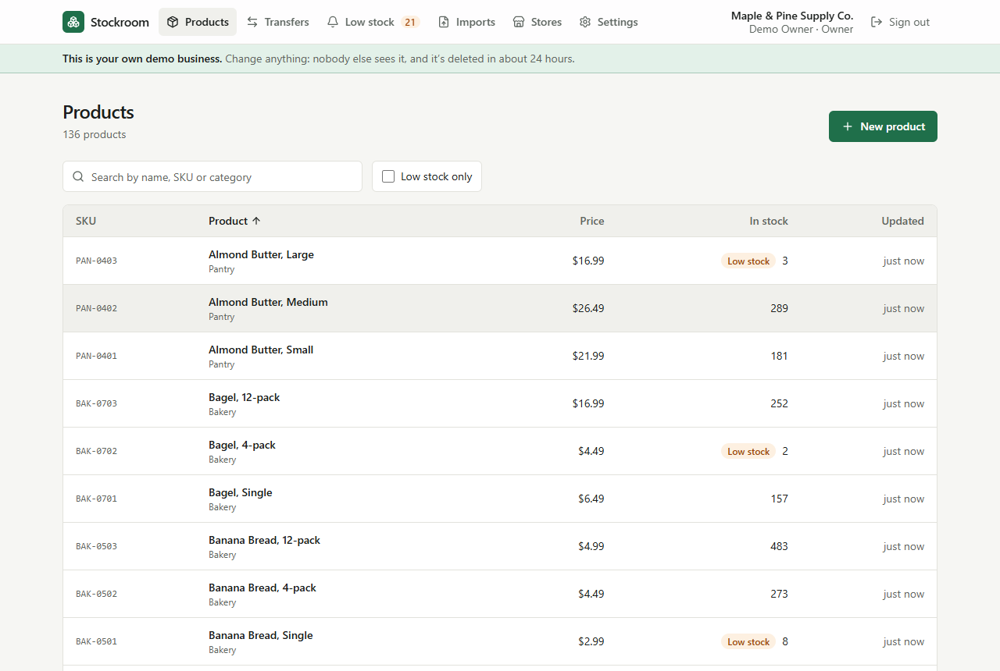

# Stockroom

Inventory for small retailers: products, stock across several stores, transfers between them, a full history of every change, low-stock alerts sent as signed webhooks, staff accounts, and spreadsheet imports of up to 100,000 rows that run in the background. Built to be correct under concurrency and failure, and to run entirely on free hosting.




> **Status:** feature-complete and ready to deploy for free (Render, Neon and Upstash; see [docs/deploy.md](docs/deploy.md)). On the live demo, **Try the demo** gives each visitor a private sample business for 24 hours. See the [roadmap](#roadmap).

## What's interesting here

- **Measured, not guessed.** A load-test harness and query plans took the 100,000-product list from 1.6 s to 6 ms for the low-stock filter (275×), and from 902 ms to 6 ms for sorting by stock (150×). The changes: stock totals kept by statement-level triggers, keyset paging, counts that stop at 10,000, and trigram search. The write-up includes the costs (imports 46% slower), a regression found by measuring (a trigger doing 16 million comparisons per chunk), and why there's no cache. ([performance.md](docs/performance.md), [ADR 0009](docs/adr/0009-read-performance.md))
- **Imports that survive a crash.** Each chunk of 1,000 rows commits together with its checkpoint, so a crashed import resumes exactly where it stopped. In a test, the server was hard-killed partway through a 100,000-row import. After a restart the import finished, and its 197,463 stock changes matched its ledger exactly. ([ADR 0006](docs/adr/0006-bulk-import-pipeline.md))
- **Postgres records the work, the queue delivers it.** An upload is saved in Postgres before it's queued. If Redis loses the job, a sweeper queues it again. Two workers can never apply the same chunk, because the checkpoint doubles as a fencing token.
- **Fast on cheap hardware.** A 100,000-row file imports in about 40 seconds on a laptop: each chunk is a handful of set-based SQL statements, not a query per row. Importing the same file again changes nothing, because stock columns are counts, not changes.
- **A stock ledger that can't oversell.** Every change is an append-only movement written in the same transaction as the balance. A `CHECK (quantity >= 0)` constraint rejects overselling: in tests, 12 simultaneous sales against 5 units give exactly 5 successes. ([ADR 0002](docs/adr/0002-stock-ledger.md))
- **Events that can't be lost or invented.** Every alert and transfer event is written to an outbox table in the same transaction as the change. A relay hands batches to workers with `FOR UPDATE SKIP LOCKED`, and they're delivered as webhooks signed with HMAC-SHA256, retried with backoff, and logged per attempt. A rolled-back change sends nothing; a committed one can't be lost. ([ADR 0007](docs/adr/0007-outbox-and-webhooks.md))
- **One lock order, tested against a real race.** Imports, transfers and sales take row locks in the same order, so they can't deadlock. A test holds two sales of one product open at once: it passes with the product lock and fails every time without it. ([ADR 0008](docs/adr/0008-transfers-and-lock-order.md))
- **Webhooks that can't be aimed inward.** User-supplied URLs are checked against private and metadata address ranges when saved and again at connection time, which also stops DNS rebinding (SSRF).
- **Least-privilege staff.** Single-use invite links (hashed, expiring). Staff can move stock but not change prices or settings. Removing someone ends their sessions at once and keeps their name on the history.
- **Safe retries.** Stock changes accept an `Idempotency-Key`, and identical uploads are recognised by their hash, so retried requests don't apply anything twice. ([ADR 0003](docs/adr/0003-idempotency-keys.md))
- **Live progress** over server-sent events, with one Redis subscription per server process instead of one per viewer.
- **Observable.** Prometheus metrics for request latency by route, queue depths, the outbox backlog and database pool waits.
- **A live demo that can't be vandalised.** Each visitor gets their own sandbox business, seeded in about 0.3 s and deleted after 24 hours. Creation is rate-limited and capped, so a free 1 GB database can't fill up. ([deploy.md](docs/deploy.md))
- **Free hosting, budgeted.** BullMQ's polling and the background timers are tuned so the worst case fits inside Upstash's 500,000 commands and Neon's 100 compute-hours a month, with the calculations written down.
- **Written down.** [Architecture](docs/architecture.md) with diagrams, a failure-modes table and a scaling plan, [performance](docs/performance.md) with method and results, and [decision records](docs/adr) with the trade-offs.

## Run it locally

No Docker needed: `npm run db` starts a real PostgreSQL server from an npm package.

**Requirements:** Node.js 22.12 or later, and Redis 6.2 or later on `localhost:6379`. On Windows, Redis runs in WSL: `wsl -d Ubuntu -- redis-server --daemonize yes`.

```bash
npm install
npm run dev        # starts Postgres (port 5433), the API and background workers (3000), and the web app (5173)
```

In a second terminal, add the demo data once:

```bash
npm run db:seed
```

Open http://localhost:5173 and choose **Try the demo** for a private sandbox business, or **Fill in the local demo account** (`demo@stockroom.app` / `stockroom-demo`), or create your own account.

To try a big import, generate a file for the demo business's stores and upload it on the **Imports** page:

```bash
npm run sample:import -- --rows 100000     # writes .data/imports/sample-100000.csv
```

In development, webhooks may point at `localhost`, so you can test them with a local receiver. Production only allows public `https` URLs.

Postgres keeps its data in `.data/postgres`. Delete that folder to start fresh.

### Scripts

| Command | What it does |
|---|---|
| `npm run dev` | Postgres, API, worker and web app together, with reload on change |
| `npm run db` | Only the local Postgres server |
| `npm run db:seed` | Recreates the demo business: 3 stores, 136 products, opening stock |
| `npm run sample:import` | Writes a large import file with a few deliberate mistakes (`--rows`, `--stores`, `--bad`) |
| `npm test` | API and import tests against a throwaway Postgres and your local Redis |
| `npm run typecheck` | Type-checks every package |
| `npm run build` | Builds the web app and bundles the server |
| `npm start` | Runs the production build: one process serving the API and web app, and processing imports |
| `npm run db:generate` | Generates a migration after a change to `apps/server/src/db/schema.ts` |
| `npm run bench` | Load-tests the API against a 100,000-product business and prints a table (`--label`, `--compare`, `--only`) |
| `npm run explain` | Prints query plans for the product list's main queries |

## Stack

| | |
|---|---|
| **API** | Node.js, Express 5, TypeScript, Drizzle ORM, PostgreSQL, Zod, pino |
| **Background jobs** | BullMQ on Redis: imports and webhook delivery; a transactional outbox in Postgres; CSV via `csv-parse`, Excel via `read-excel-file` |
| **Web** | React 19, React Router, TanStack Query, Tailwind CSS, Vite; live progress over server-sent events |
| **Tests** | Vitest and Supertest against real Postgres and Redis (no mocks) |
| **Performance** | autocannon load tests, `EXPLAIN ANALYZE`, Prometheus metrics via prom-client |

## Project layout

```
apps/
  server/            Express API and background workers; serves the built web app in production
    src/modules/     auth, stores, products, stock, imports, transfers, alerts, events, webhooks, team
    src/http/        auth, idempotency, validation and error middleware
    src/db/          schema, migrations, seed data
    drizzle/         generated SQL migrations
    test/            API, import and failure tests
  web/               React app
packages/
  shared/            Zod schemas and types shared by the API and the web app
docs/
  architecture.md    how it works, failure modes, scaling plan
  deploy.md          free deployment: Render, Neon, Upstash, with budgets
  performance.md     load tests, query plans, trade-offs
  adr/               decision records
scripts/
  dev-db.ts          local Postgres without Docker
  generate-import.ts sample import files
  bench.ts           load tests
  explain.ts         query plans
```

## Roadmap

- [x] **Phase 1: foundation.** Accounts and businesses, stores, products, the stock ledger, idempotency keys, tests and CI
- [x] **Phase 2: bulk imports.** CSV and Excel files of up to 100,000 rows, processed in the background in chunks that resume after a crash, with live progress and a per-row problem report
- [x] **Phase 3: operations.** Transfers between stores, low-stock alerts through a transactional outbox, signed webhooks with retries, staff accounts with invite links
- [x] **Phase 4: performance.** Load tests and query plans; stock totals kept by triggers, keyset paging, capped counts and trigram search; Prometheus metrics. [Results](docs/performance.md)
- [ ] **Phase 5: live demo.** ~~Sandbox business per visitor~~ (done), ~~free deployment config and guide~~ (done); next, the live link
