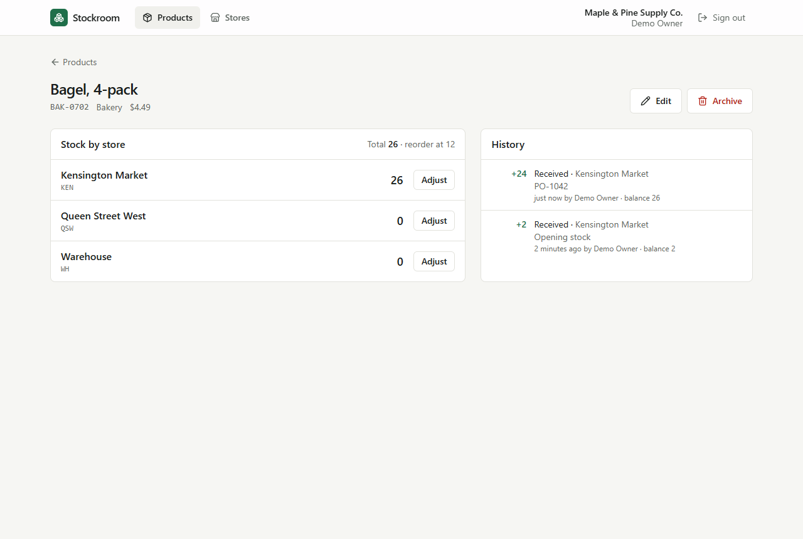

# Stockroom

Inventory for small retailers: products, stock across several stores, and a full history of every change. Built to be correct under concurrency and to run entirely on free hosting.




> **Status:** phase 1 of 5 is done (accounts, stores, products and the stock ledger). The bulk-import pipeline is next. See the [roadmap](#roadmap).

## What's interesting here

- **A stock ledger that can't oversell.** Every change is an append-only movement, written in the same transaction as the running balance. The database computes the new balance while holding the row lock, and a `CHECK (quantity >= 0)` constraint rejects overselling. The tests fire 12 simultaneous sales at 5 units and get exactly 5 successes. ([ADR 0002](docs/adr/0002-stock-ledger.md))
- **Safe retries.** Stock changes accept an `Idempotency-Key`, so a request retried after a timeout is applied once and gets the original response back. ([ADR 0003](docs/adr/0003-idempotency-keys.md))
- **Tenant isolation, tested.** Every query is scoped to the signed-in business, and tests try to read and change another business's data by id. ([Architecture: multi-tenancy](docs/architecture.md#multi-tenancy))
- **Designed for free hosting.** One Node service serves the API and the web app; Postgres holds everything durable. ([ADR 0005](docs/adr/0005-free-tier-hosting.md))
- **Written down.** [Architecture](docs/architecture.md) with diagrams, a failure-modes table, capacity estimates and a scaling plan, plus [decision records](docs/adr) with the trade-offs.

## Run it locally

No Docker needed: `npm run db` starts a real PostgreSQL server from an npm package.

**Requirements:** Node.js 22.12 or later.

```bash
npm install
npm run dev        # starts Postgres (port 5433), the API (3000) and the web app (5173)
```

In a second terminal, add the demo data once:

```bash
npm run db:seed
```

Open http://localhost:5173 and choose **Fill in the demo account** (`demo@stockroom.app` / `stockroom-demo`), or create your own account.

Postgres keeps its data in `.data/postgres`. Delete that folder to start fresh.

### Scripts

| Command | What it does |
|---|---|
| `npm run dev` | Postgres, API and web app together, with reload on change |
| `npm run db` | Only the local Postgres server |
| `npm run db:seed` | Recreates the demo business: 3 stores, 136 products, opening stock |
| `npm test` | API tests against a throwaway Postgres started for the run |
| `npm run typecheck` | Type-checks every package |
| `npm run build` | Builds the web app and bundles the server |
| `npm start` | Runs the production build: one process serving the API and the web app on port 3000 |
| `npm run db:generate` | Generates a migration after a change to `apps/server/src/db/schema.ts` |

## Stack

| | |
|---|---|
| **API** | Node.js, Express 5, TypeScript, Drizzle ORM, PostgreSQL, Zod, pino |
| **Web** | React 19, React Router, TanStack Query, Tailwind CSS, Vite |
| **Tests** | Vitest and Supertest against a real Postgres (no mocks) |
| **Planned** | Redis and BullMQ for background imports, server-sent events for progress |

## Project layout

```
apps/
  server/          Express API; serves the built web app in production
    src/modules/   auth, stores, products, stock: routes and queries per area
    src/http/      auth, idempotency, validation and error middleware
    src/db/        schema, migrations, seed data
    drizzle/       generated SQL migrations
    test/          API tests
  web/             React app
packages/
  shared/          Zod schemas and types shared by the API and the web app
docs/
  architecture.md  how it works, failure modes, scaling plan
  adr/             decision records
scripts/
  dev-db.ts        local Postgres without Docker
```

## Roadmap

- [x] **Phase 1: foundation.** Accounts and businesses, stores, products, the stock ledger, idempotency keys, tests and CI
- [ ] **Phase 2: bulk imports.** Upload a spreadsheet of up to ~100k rows, processed in the background in chunks that resume after a crash, with live progress and a per-row error report
- [ ] **Phase 3: operations.** Transfers between stores, low-stock alerts sent through a transactional outbox, staff accounts
- [ ] **Phase 4: performance.** Load tests with published numbers, Redis caching, metrics
- [ ] **Phase 5: live demo.** Free deployment, with a sandbox business per visitor that is deleted after a day
