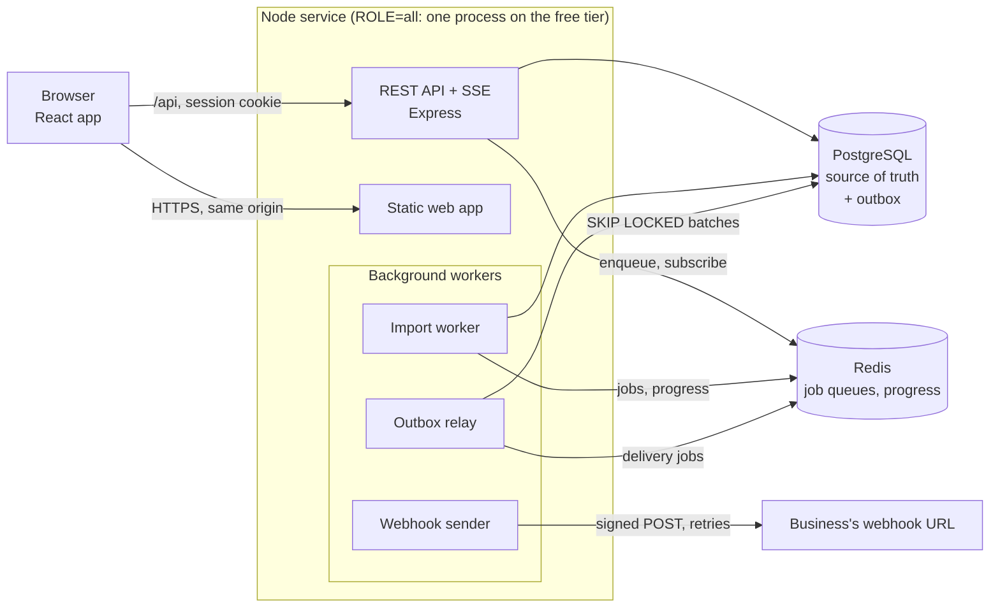
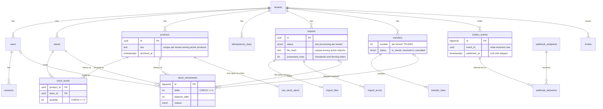
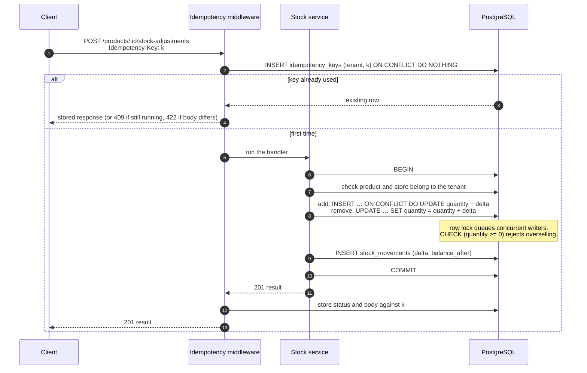
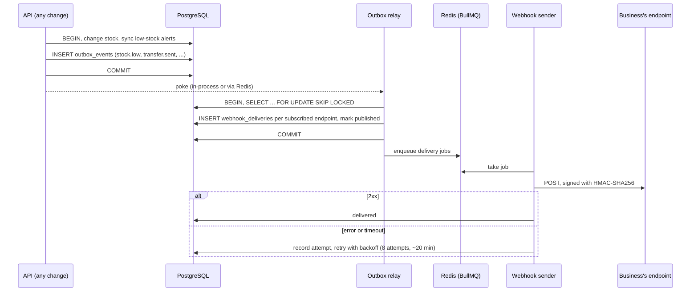

# Architecture

Stockroom is inventory software for small retailers: a business has stores, products and stock in each store, and every change to stock is recorded. This document covers how it's built, why, and how it would grow.

Sections marked **(planned)** describe work on the roadmap that isn't built yet.

## Constraints

These shaped most of the decisions below.

- **Free hosting.** The live demo has to run on free tiers: one small Node instance (around 0.1 vCPU and 512 MB), a free managed Postgres and, from phase 2, a free managed Redis. No paid object storage and no AWS.
- **One instance.** Free tiers give one instance that may sleep when idle. The design must be correct on one instance, and must not *depend* on being one, so it can scale out later.
- **Correct under concurrency.** Two cashiers selling the last unit at the same moment must not take stock below zero. A network retry must not apply a change twice.

## System overview



The web app and the API are served from the same origin by the same process. That means:

- no CORS configuration;
- the session cookie is first-party, so browser third-party-cookie blocking can't break it;
- one free web service hosts everything.

`ROLE` picks what a process runs: `all` (the default), `api` or `worker`. They're the same code. Splitting them lets background work scale separately from the API, with no code changes: Postgres and Redis are the only things between them.

### Code layout

```
apps/server     Express API and the background workers; serves the built web app in production
apps/web        React single-page app
packages/shared Zod schemas and types used by both, so validation rules can't drift apart
```

The server is a **modular monolith**: `auth`, `products`, `stock`, `stores`, `imports`, `transfers`, `alerts`, `events` (outbox and relay), `webhooks` and `team` each own their routes and queries under `modules/`, and talk to each other through plain functions rather than over the network. See [ADR 0001](adr/0001-modular-monolith.md).

## Data model



- **`stock_movements` is an append-only ledger** and the source of truth for history. **`stock_levels` holds the current balance**, updated in the same transaction as each movement, so reads don't have to add up the ledger. See [ADR 0002](adr/0002-stock-ledger.md).
- **Products are archived, not deleted**, so their history stays intact. A partial unique index (`WHERE archived_at IS NULL`) frees an archived product's SKU for reuse.
- Every business table has a `tenant_id`. Deleting a tenant cascades to all of its data.

## Key flows

### Changing stock



Why this shape:

- **No read-then-write.** The new balance is computed by the database (`quantity + delta`) while it holds the row lock, so concurrent requests can't both read "5" and both write "4". Tests fire 25 concurrent increments and 12 concurrent sales against 5 units. The increments all land, and exactly 5 of the 12 sales succeed.
- **The constraint is the guard.** `CHECK (quantity >= 0)` is what stops overselling, not application code. If it fires, the transaction rolls back and nothing reaches the ledger.
- **One Postgres detail matters here.** An upsert can't remove stock: Postgres checks constraints on the row an `INSERT` *proposes* before it notices the conflict, so inserting a negative quantity fails even when the existing row has plenty. Removals therefore use a plain `UPDATE`. The test suite caught this.

### Bulk import

Upload a CSV or Excel file of up to 100,000 rows and it's applied in the background, with live progress and a report of rows that were skipped. One row is one product: `sku, name, category, price, reorder_point, stock:<store code>…`. An empty cell means "leave as is". A `stock:` cell is the counted quantity in that store. The full design and its trade-offs are in [ADR 0006](adr/0006-bulk-import-pipeline.md).

```mermaid
sequenceDiagram
  participant C as Browser
  participant A as API
  participant Q as Redis (BullMQ)
  participant W as Worker
  participant DB as PostgreSQL

  C->>A: POST /imports (raw file body)
  A->>DB: one transaction: imports row + file (bytea)
  A->>Q: add job (job id = import id)
  A-->>C: 202 Accepted
  C->>A: GET /imports/:id/events (SSE)
  A-->>C: current state from Postgres
  W->>Q: take job
  W->>DB: claim (status = processing; one per tenant)
  W->>W: pass 1: check header, count rows
  loop each chunk of 1,000 rows after the checkpoint
    W->>DB: BEGIN, move checkpoint (fails if another worker moved it)
    W->>DB: upsert products, set stock, write ledger, save problems
    W->>DB: COMMIT
    W->>Q: publish summary
    Q-->>A: summary (one subscription per API process)
    A-->>C: progress event
  end
  W->>DB: completed, delete file
  A-->>C: final event, stream closes
```

What makes it hold up:

- **The request path stays fast.** The API stores the file and queues it (about 280 ms for a 6 MB file). Parsing happens in the worker.
- **Postgres records the work, the queue delivers it.** If queueing fails, a sweeper re-queues it later. Losing Redis delays imports but loses none.
- **Each chunk commits with its checkpoint**, so a crash resumes exactly where it stopped. The checkpoint doubles as a fencing token, so two workers can't both apply the same chunk.
- **Re-applying is harmless.** Stock cells are counts, not changes, so running rows again writes nothing.
- **Bad rows are skipped, not fatal.** Every problem is reported with its spreadsheet row number and column, and the rest of the file still imports. Problems with the file itself, such as an unknown column or a store code that doesn't exist, fail the import before anything is written.
- **Fair between businesses.** Each business gets one running import at a time; others wait their turn without blocking other businesses.
- **The same file can't run twice at once.** A unique index on (tenant, file hash) among active imports turns a double-click into the same import.

### Transfers

Sending takes stock out of the source store straight away. Receiving adds what arrived to the destination and records any shortfall. Cancelling puts the stock back. Status changes are guarded `UPDATE`s, so pressing Receive twice adds the stock once. See [ADR 0008](adr/0008-transfers-and-lock-order.md).

### Lock order

Every writer takes row locks in the same order, so no two can deadlock:

1. the transfer row (receive, cancel)
2. products, by id
3. stock levels, by (product, store)
4. low-stock alerts

Locking the product first also keeps the low-stock check correct when two stores sell the same product at once. A test forces that race and fails without the lock.

### Events, alerts and webhooks



- **Events are written in the change's own transaction**, so an event exists exactly when its change committed. See [ADR 0007](adr/0007-outbox-and-webhooks.md).
- **Low-stock alerts compare state, not deltas.** After any stock change, one SQL statement opens an alert for each product at or below its reorder point and resolves alerts that recovered. It writes `stock.low` and `stock.restocked` events as it goes, and a partial unique index allows one open alert per product.
- **Delivery is at least once and unordered.** Each request carries an event id for de-duplication and a Stripe-style signature.
- **Webhooks can't reach private networks.** URLs are checked when saved and again at connection time.

## Multi-tenancy

A business is a tenant. Isolation is enforced in three places:

1. **The session decides the tenant.** No endpoint accepts a tenant id from the client.
2. **Every query filters on `tenant_id`**, including lookups by primary key. A product id from another tenant behaves exactly like an id that doesn't exist (404), so ids can't be probed.
3. **Tests try to cross the boundary.** One tenant attempts to read, edit, archive, view history of and adjust another tenant's product, and to use another tenant's store id.

Postgres row-level security would add a fourth layer that holds even if a query forgets its filter. It's on the roadmap; it needs every request to run in a transaction that sets the tenant, which is a bigger change than it looks.

## Security

| Concern | What's done |
|---|---|
| Roles | Owners do everything. Staff can view everything, change stock and handle transfers, but can't edit products, run imports or change stores, the team or webhooks. Enforced by the API; the web app only hides what the API would refuse. |
| Team changes | Invite links are random 256-bit tokens, stored hashed, single-use (a guarded `UPDATE`), expiring after 7 days. Removing someone deactivates them and deletes their sessions, so access ends on their next request, and their name stays on the history they made. |
| Webhooks | Signed with HMAC-SHA256 and a timestamp. Destination URLs must be public `https`, checked when saved and again at connection time, with redirects not followed (SSRF). |
| Passwords | scrypt (built into Node, so there's no native module to compile on free hosts), with per-hash salt and cost settings stored alongside |
| Sessions | Random 256-bit token in an `HttpOnly`, `SameSite=Lax`, `Secure` cookie. Only its SHA-256 hash is stored, so a database leak can't be replayed. Sign-out deletes it server-side. See [ADR 0004](adr/0004-server-side-sessions.md). |
| CSRF | `SameSite=Lax` stops browsers sending the cookie on cross-site POSTs; the API only accepts JSON bodies |
| Account enumeration | Sign-in gives the same error, and does the same password-hashing work, whether or not the email exists |
| Brute force | Sign-in and sign-up are rate-limited per IP |
| Headers | Helmet: CSP, HSTS, `nosniff`, frame denial |
| Input | Every body, query and path parameter is validated with Zod; errors list each invalid field |
| SQL | Parameterised queries throughout; `LIKE` wildcards in search input are escaped |

## Failure modes

| What happens | Behaviour |
|---|---|
| Database not up yet at boot | The server retries for 30 s before giving up, so a slow local or cold-starting free database doesn't crash it |
| Hosted Postgres drops an idle connection | The pool's error listener logs it and the pool opens a new connection on next use, instead of the process crashing |
| Client times out and retries a stock change | The `Idempotency-Key` returns the original response; the change is applied once |
| Server crashes mid-request after claiming a key | The key is left "in progress"; after 60 s a retry takes it over and runs the request |
| Two sales race for the last unit | Row lock queues them; the second hits `CHECK (quantity >= 0)` and gets 409 `insufficient_stock` |
| Two people create the same SKU at once | The unique index rejects the second; it gets 409 `sku_taken` |
| Deploy or shutdown | `SIGTERM` stops new connections and gives in-flight requests 5 s. The worker finishes its current chunk and puts the import back on the queue, so another worker resumes it straight away. Then the pool closes. |
| Worker killed mid-import (crash, out of memory) | The job's lock expires and BullMQ hands it to a worker, which resumes from the last committed chunk. **Tested:** hard-killed at 32,000 of 100,000 rows; it resumed about a minute later, finished, and its 197,463 stock changes matched its ledger rows exactly. |
| A stalled job reaches a second worker while the first still runs | The checkpoint acts as a fencing token: a chunk commits only if the checkpoint hasn't moved, so the loser stops before writing. Tested by running two workers on one import at once. |
| Redis unavailable | Uploads still succeed (the import is saved in Postgres). The sweeper queues it once Redis is back. Live progress pauses, and the page falls back to polling. Everything except imports keeps working. |
| A change commits but the process dies before notifying anyone | Its outbox event was committed with it. The relay finds it on its next run (at most ~30 s later). |
| A change rolls back | Its outbox event rolls back too, so nothing is sent for it. Tested. |
| A webhook endpoint is down or slow | Each attempt is recorded. Retries back off over ~20 minutes, then the delivery is marked failed. Other endpoints aren't held up. |
| Two relays run at once | `SKIP LOCKED` gives each a different batch. A delivery is unique per (endpoint, event), so nothing is sent twice. |
| Two people receive the same transfer | The guarded status update lets one through; the other gets 409. Stock is added once. Tested with three at once. |
| Two people use the same invite link | One account is created; the others get 410. Tested. |
| Same file uploaded twice (double-click, retried request) | A unique index on (tenant, file hash) among active imports returns the existing import instead of starting another |
| A row has bad data | That row is skipped and reported with its row number and column; the rest still import |
| The file itself is wrong (no `sku` column, unknown store code, too many rows) | The import fails before writing anything, with a message saying what to fix |

## Capacity and scaling

### Rough sizing

These are estimates for planning. Measured numbers will replace them in phase 4.

- A typical small retailer: ~2,000 SKUs × 3 stores ≈ **6,000 stock rows**, and maybe **500 stock movements a day**.
- A movement row plus its index entries is roughly **150 bytes**, so one tenant adds ~75 KB a day, or ~27 MB a year.
- A free Postgres tier of ~0.5 GB therefore holds a **few dozen active demo tenants for a year**, which is plenty for a portfolio demo. Old demo tenants will be deleted by a scheduled job.

### Measured so far

On a laptop, with the production build and local Postgres and Redis:

| What | Result |
|---|---|
| Upload a 100,000-row, 6 MB CSV | `202` in ~280 ms |
| Import it (99,786 new products, 296,761 stock changes) | ~27 s, ~3,700 rows/s |
| Import the same file again | 0 changes, ~6 s |
| Recover from a hard kill at 32% | Resumed about a minute after restart, results exact |

Product list, best of 3, with about 100,000 products in one business. These are the baseline that phase 4 will improve:

| Query | Time |
|---|---|
| First page, sorted by name | 171 ms |
| Page 2,000 (`OFFSET` 49,975) | 396 ms |
| Sorted by total stock | 522 ms |
| Low-stock filter | 435 ms |
| Search for "honey" | 193 ms |

Most of the cost is the `count(*)` for the page total, and summing stock per row for every product before sorting.

### What breaks first, and what to do about it

| Pressure | First fix | Later |
|---|---|---|
| Product list sorts and filters by total stock, computed per row (522 ms at 100k) | Keep a `total_stock` column on `products`, maintained in the same transaction as stock changes, and index it | — |
| Exact page totals cost a `count(*)` on every page | Show "about N" from the planner's estimate beyond a threshold | — |
| Deep pages of the product list (`OFFSET`) | Keyset pagination, as stock history already uses | — |
| Search with `ILIKE '%term%'` | `pg_trgm` GIN index | Postgres full-text search |
| `stock_movements` grows forever (~300k rows from one import) | Index on `(tenant_id, product_id, id)` keeps history reads constant-time | Partition by month; archive old partitions |
| More than one API instance | Sessions, idempotency, stock and imports are all in Postgres, so instances are stateless | Move the rate-limit counters to Redis (they're per-process today) |
| Imports compete with the API for CPU | Run the worker as its own process (`ROLE=worker`) | Scale workers separately from the API |

## Observability

- Structured JSON logs (pino) with a request id on every line. The id comes from `X-Request-Id` if the caller sent one, and is returned in the response, so a user-reported problem can be traced.
- `/api/health` (process is up) and `/api/ready` (database reachable) for the host's health checks.
- Every import keeps its own counters, timings and problem list, which is what the import page shows.
- Redis outages are logged once when they start and once when they end, not on every retry.
- Every webhook delivery records its attempts, last status code and last error, which the settings page shows.
- Planned: Prometheus metrics (request latency histograms, queue depth, job duration) and request ids carried into background jobs.
