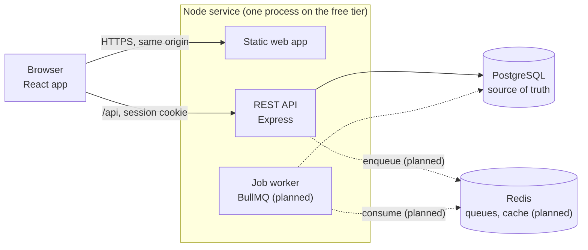
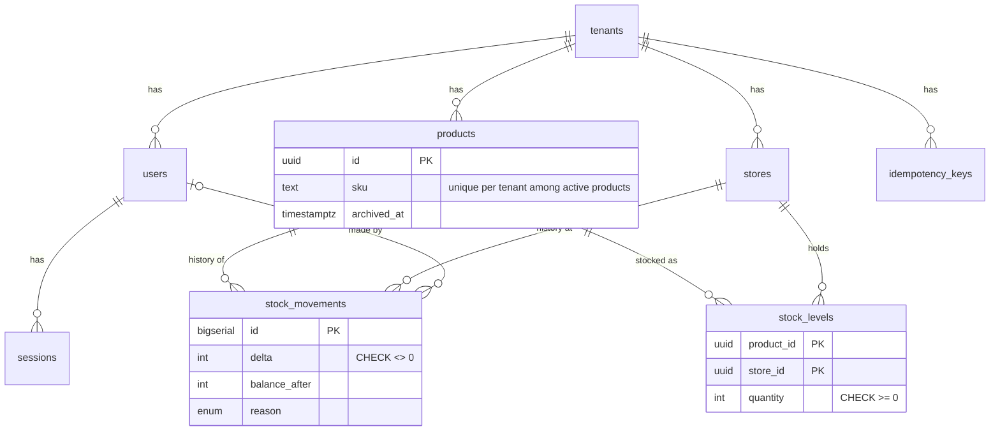
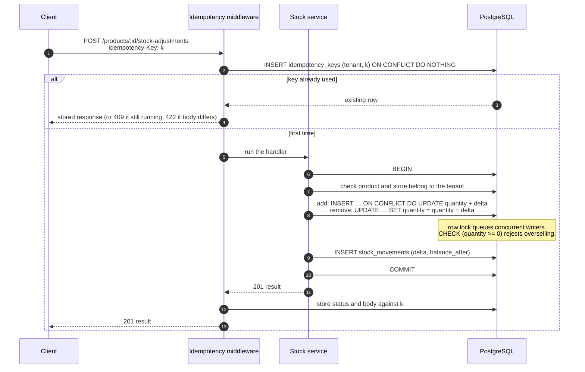
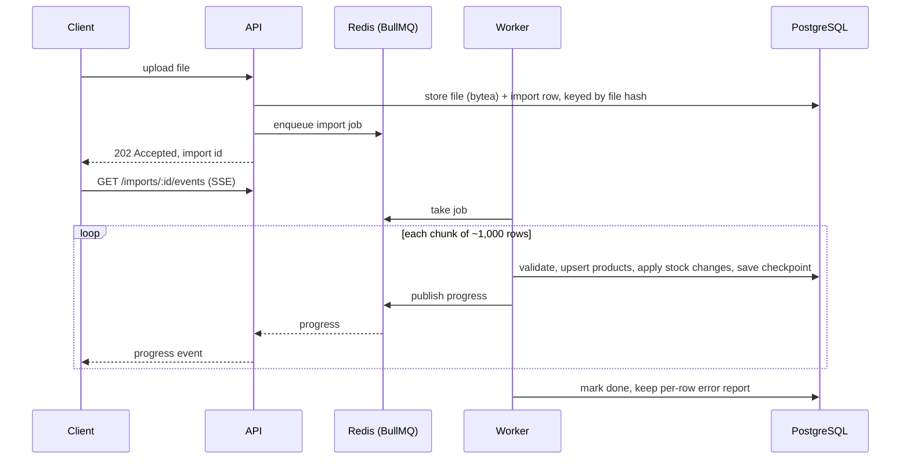

# Architecture

Stockroom is inventory software for small retailers: a business has stores, products and stock in each store, and every change to stock is recorded. This document covers how it's built, why, and how it would grow.

Sections marked **(planned)** describe work on the roadmap that isn't built yet.

## Constraints

These shaped most of the decisions below.

- **Free hosting.** The live demo has to run on free tiers: one small Node instance (around 0.1 vCPU and 512 MB), a free managed Postgres and, from phase 2, a free managed Redis. No paid object storage and no AWS.
- **One instance.** Free tiers give one instance that may sleep when idle. The design must be correct on one instance, and must not *depend* on being one, so it can scale out later.
- **Correct under concurrency.** Two cashiers selling the last unit at the same moment must not take stock below zero. A network retry must not apply a change twice.

## System overview



The web app and the API are served from the same origin by the same process. That means:

- no CORS configuration;
- the session cookie is first-party, so browser third-party-cookie blocking can't break it;
- one free web service hosts everything.

### Code layout

```
apps/server     Express API (and, from phase 2, the job worker); serves the built web app in production
apps/web        React single-page app
packages/shared Zod schemas and types used by both, so validation rules can't drift apart
```

The server is a **modular monolith**: `modules/auth`, `modules/products`, `modules/stock` and `modules/stores` each own their routes and queries, and talk to each other through plain functions rather than over the network. See [ADR 0001](adr/0001-modular-monolith.md).

## Data model



- **`stock_movements` is an append-only ledger** and the source of truth for history. **`stock_levels` holds the current balance**, updated in the same transaction as each movement, so reads don't have to add up the ledger. See [ADR 0002](adr/0002-stock-ledger.md).
- **Products are archived, not deleted**, so their history stays intact. A partial unique index (`WHERE archived_at IS NULL`) frees an archived product's SKU for reuse.
- Every business table has a `tenant_id`. Deleting a tenant cascades to all of its data.

## Key flows

### Changing stock



Why this shape:

- **No read-then-write.** The new balance is computed by the database (`quantity + delta`) while it holds the row lock, so concurrent requests can't both read "5" and both write "4". Tests fire 25 concurrent increments and 12 concurrent sales against 5 units. The increments all land, and exactly 5 of the 12 sales succeed.
- **The constraint is the guard.** `CHECK (quantity >= 0)` is what stops overselling, not application code. If it fires, the transaction rolls back and nothing reaches the ledger.
- **One Postgres detail matters here.** An upsert can't remove stock: Postgres checks constraints on the row an `INSERT` *proposes* before it notices the conflict, so inserting a negative quantity fails even when the existing row has plenty. Removals therefore use a plain `UPDATE`. The test suite caught this.

### Bulk import (planned, phase 2)

The centrepiece of the project: upload a spreadsheet of up to ~100k rows and have it applied in the background.



Design points to build and test:

- **Request path stays fast.** The API only stores the file and enqueues; parsing happens in the worker.
- **Resumable.** Each chunk commits with a checkpoint, so a worker crash or a free instance going to sleep resumes from the last chunk instead of starting over.
- **Idempotent.** Re-uploading the same file (same hash) returns the existing import.
- **Fair.** A per-tenant concurrency limit stops one tenant's 100k-row file from starving everyone else's.
- **Files in Postgres.** Uploads are stored in Postgres behind a small storage interface, because free tiers don't include object storage. See [ADR 0005](adr/0005-free-tier-hosting.md).

## Multi-tenancy

A business is a tenant. Isolation is enforced in three places:

1. **The session decides the tenant.** No endpoint accepts a tenant id from the client.
2. **Every query filters on `tenant_id`**, including lookups by primary key. A product id from another tenant behaves exactly like an id that doesn't exist (404), so ids can't be probed.
3. **Tests try to cross the boundary.** One tenant attempts to read, edit, archive, view history of and adjust another tenant's product, and to use another tenant's store id.

Postgres row-level security would add a fourth layer that holds even if a query forgets its filter. It's on the roadmap; it needs every request to run in a transaction that sets the tenant, which is a bigger change than it looks.

## Security

| Concern | What's done |
|---|---|
| Passwords | scrypt (built into Node, so there's no native module to compile on free hosts), with per-hash salt and cost settings stored alongside |
| Sessions | Random 256-bit token in an `HttpOnly`, `SameSite=Lax`, `Secure` cookie. Only its SHA-256 hash is stored, so a database leak can't be replayed. Sign-out deletes it server-side. See [ADR 0004](adr/0004-server-side-sessions.md). |
| CSRF | `SameSite=Lax` stops browsers sending the cookie on cross-site POSTs; the API only accepts JSON bodies |
| Account enumeration | Sign-in gives the same error, and does the same password-hashing work, whether or not the email exists |
| Brute force | Sign-in and sign-up are rate-limited per IP |
| Headers | Helmet: CSP, HSTS, `nosniff`, frame denial |
| Input | Every body, query and path parameter is validated with Zod; errors list each invalid field |
| SQL | Parameterised queries throughout; `LIKE` wildcards in search input are escaped |

## Failure modes

| What happens | Behaviour |
|---|---|
| Database not up yet at boot | The server retries for 30 s before giving up, so a slow local or cold-starting free database doesn't crash it |
| Hosted Postgres drops an idle connection | The pool's error listener logs it and the pool opens a new connection on next use, instead of the process crashing |
| Client times out and retries a stock change | The `Idempotency-Key` returns the original response; the change is applied once |
| Server crashes mid-request after claiming a key | The key is left "in progress"; after 60 s a retry takes it over and runs the request |
| Two sales race for the last unit | Row lock queues them; the second hits `CHECK (quantity >= 0)` and gets 409 `insufficient_stock` |
| Two people create the same SKU at once | The unique index rejects the second; it gets 409 `sku_taken` |
| Deploy or shutdown | `SIGTERM` stops new connections, lets in-flight requests finish (up to 10 s), then closes the pool |
| Redis unavailable (planned) | Imports queue up and the API keeps serving reads and manual stock changes, which don't need Redis |

## Capacity and scaling

### Rough sizing

These are estimates for planning. Measured numbers will replace them in phase 4.

- A typical small retailer: ~2,000 SKUs × 3 stores ≈ **6,000 stock rows**, and maybe **500 stock movements a day**.
- A movement row plus its index entries is roughly **150 bytes**, so one tenant adds ~75 KB a day, or ~27 MB a year.
- A free Postgres tier of ~0.5 GB therefore holds a **few dozen active demo tenants for a year**, which is plenty for a portfolio demo. Old demo tenants will be deleted by a scheduled job.

### What breaks first, and what to do about it

| Pressure | First fix | Later |
|---|---|---|
| Product list sorts by total stock, computed per row | It reads `stock_levels` by primary key; fine at thousands of products per tenant | Keep a `total_stock` column on `products`, maintained in the stock transaction |
| Deep pages of the product list (`OFFSET`) | Fine for UI page sizes | Keyset pagination, as stock history already uses |
| Search with `ILIKE '%term%'` | Fine at thousands of rows per tenant | `pg_trgm` GIN index |
| `stock_movements` grows forever | Index on `(tenant_id, product_id, id)` keeps history reads constant-time | Partition by month; archive old partitions |
| More than one API instance | Sessions, idempotency and stock are already in Postgres, so instances are stateless | Move the rate-limit counters to Redis (they're per-process today) |
| Imports slow down the API (planned) | Run the worker as its own process (`ROLE=worker`) | Scale workers separately from the API |

## Observability

- Structured JSON logs (pino) with a request id on every line. The id comes from `X-Request-Id` if the caller sent one, and is returned in the response, so a user-reported problem can be traced.
- `/api/health` (process is up) and `/api/ready` (database reachable) for the host's health checks.
- Planned: Prometheus metrics (request latency histograms, queue depth, job duration) and request ids carried into background jobs.
