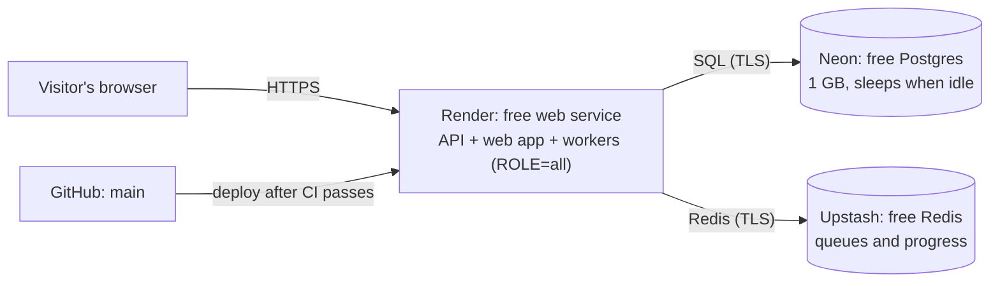

# Deploying for free

The live demo runs on three free plans, with no credit card:



Each visitor who presses **Try the demo** gets a private sample business that's deleted after 24 hours, so the free database can't fill up. Open sign-ups are turned off on the demo (`SIGNUPS_ENABLED=false`).

Free plans change. These steps and limits were checked in November 2026.

## 1. Postgres on Neon

1. Sign up at [neon.com](https://neon.com) (GitHub sign-in works).
2. **Create a project:** name `stockroom`, the newest Postgres version offered, region **AWS US East 2 (Ohio)**. That's the same area as the Render region in `render.yaml`.
3. **Cap compute:** in the project's compute settings, set the maximum size to **0.25 CU** and leave *scale to zero* on. That's what keeps usage under the 100 CU-hours a month.
4. **Copy the connection string:** open **Connect**, turn **connection pooling off** (use the direct connection) and copy the string. It looks like:

   ```
   postgresql://neondb_owner:…@ep-something-123456.us-east-2.aws.neon.tech/neondb?sslmode=require&channel_binding=require
   ```

You don't need to create any tables: the server runs its migrations each time it starts.

## 2. Redis on Upstash

1. Sign up at [upstash.com](https://upstash.com).
2. **Create a Redis database:** name `stockroom`, **regional**, in the US East region closest to Ohio.
3. Leave **eviction off**. BullMQ keeps its queues in Redis and must never have keys evicted.
4. Copy the **TLS** connection URL, which starts with `rediss://` (two s's):

   ```
   rediss://default:…@something-12345.upstash.io:6379
   ```

## 3. The app on Render

1. Sign up at [render.com](https://render.com) with GitHub, and allow it to see the `stockroom` repository.
2. **New → Blueprint**, then pick the repository. Render reads `render.yaml` and shows one free web service.
3. When it asks for **`DATABASE_URL`** and **`REDIS_URL`**, paste the two strings from steps 1 and 2. Everything else is already set in `render.yaml`.
4. **Apply.** The first build takes a few minutes. When the log shows `Server listening`, open the service's URL (something like `https://stockroom.onrender.com`).

After that, every push to `main` deploys automatically once GitHub Actions CI has passed (`autoDeployTrigger: checksPass`).

## 4. Check it

- `https://<your-app>/api/health` returns `{"status":"ok"}`, and `/api/ready` returns `{"status":"ready"}` (the database is reachable).
- Press **Try the demo**: you should land on 136 products with a banner saying the business is yours for 24 hours.
- Metrics: copy `METRICS_TOKEN` from the service's **Environment** page (Render generated it), then:

  ```bash
  curl -H "Authorization: Bearer $METRICS_TOKEN" https://<your-app>/metrics
  ```

## How it stays free

| Plan | Limit | How Stockroom stays inside it |
|---|---|---|
| Render web service | 750 instance-hours a month; sleeps after 15 minutes without requests; 512 MB | One service runs everything. It sleeps when nobody's visiting, and the first visit after that waits about a minute. Imports and webhooks resume after the wake-up. |
| Neon Postgres | 100 CU-hours a month; 1 GB; sleeps after 5 idle minutes | See the compute calculation below. |
| Upstash Redis | 500,000 commands a month | See the command calculation below. |

**Neon compute.** The database only uses hours while queries arrive. Real work (requests, imports) triggers its own queries straight away; only the safety nets run on a timer. With `SWEEP_INTERVAL_MS` and `OUTBOX_POLL_MS` at 30 minutes, an awake but idle app lets the database sleep for 25 of every 30 minutes. Worst case, if something kept Render awake all month: 750 h × (5/30) × 0.25 CU ≈ **31 CU-hours** plus real traffic, against a limit of 100. A few visits a day uses a handful.

**Upstash commands.** An idle BullMQ worker keeps asking Redis for work. With the defaults (every 5 s), two workers would use about 500,000 commands a month on their own. With `QUEUE_DRAIN_DELAY_SECONDS=60` and `QUEUE_STALLED_INTERVAL_MS=120000`, they use roughly 7 commands a minute while the app is awake. Worst case, awake for all of Render's 750 hours: 750 × 60 × 7 ≈ **315,000 a month**, under the 500,000 limit. Real traffic adds a few commands per import chunk and webhook. A sleeping app uses none.

**Neon storage.** A demo business takes about 0.3 MB, and at most 100 exist at once (`DEMO_MAX_ACTIVE`). Demo imports are capped at 2,000 rows and other imports at 20,000. Sign-ups are off, so nobody can upload 100,000-row files to the public demo.

### Don't

- **Don't add an uptime pinger** (UptimeRobot and similar). It would keep Render awake all month, and your queries would keep Neon awake too. Let it sleep; the minute-long first load is the price of free.
- **Don't turn Upstash eviction on.** Evicted BullMQ keys mean lost or stuck jobs. (The sweepers would re-queue them from Postgres eventually, but don't rely on that.)

## Troubleshooting

| Symptom | Likely cause |
|---|---|
| Deploy fails its health check, and the log shows `DATABASE_URL must be set` or `REDIS_URL must be set` | An environment variable is missing on Render's **Environment** page |
| Log shows a `channel_binding` or SCRAM error connecting to Neon | Remove `&channel_binding=require` from `DATABASE_URL` |
| Log shows `Redis is unavailable; retrying` | The URL must start with `rediss://` (TLS), and the database must exist and not be archived |
| Imports stay "Queued" | Redis is unreachable or out of commands. Check Upstash's usage page; the sweeper re-queues imports once Redis is back. |
| First visit shows Render's loading page for about a minute | The free instance was asleep. That's expected. |

## Outgrowing free

Everything below is configuration, not code:

1. **Render Starter** (about $7 a month) removes sleeping and the 750-hour cap.
2. **Run the API and workers separately:** a second service with `ROLE=worker`, and `ROLE=api` on the web service.
3. **Bigger Postgres and Redis** by changing `DATABASE_URL` and `REDIS_URL`. Put the safety-net timers back to their defaults by removing `SWEEP_INTERVAL_MS`, `OUTBOX_POLL_MS` and the `QUEUE_*` settings.
4. **Open sign-ups** with `SIGNUPS_ENABLED=true`, and raise `IMPORT_MAX_ROWS`.
